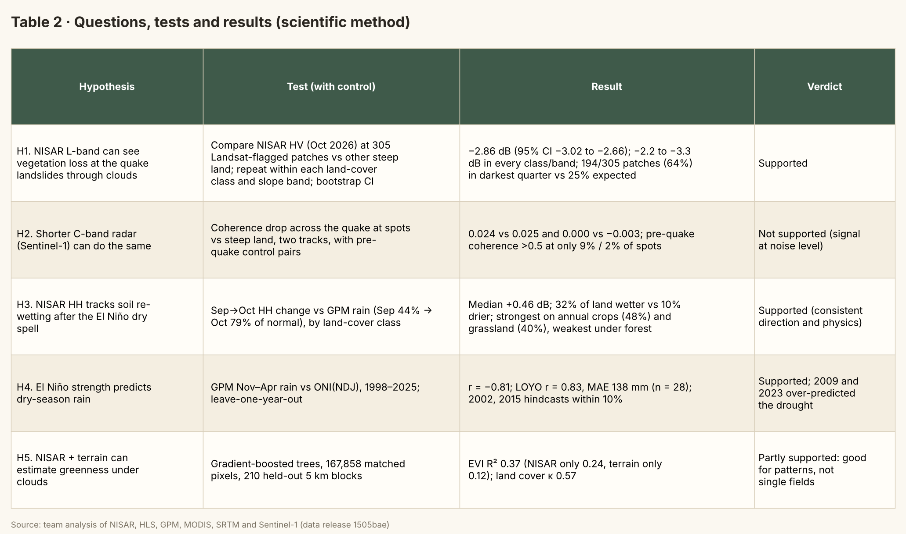
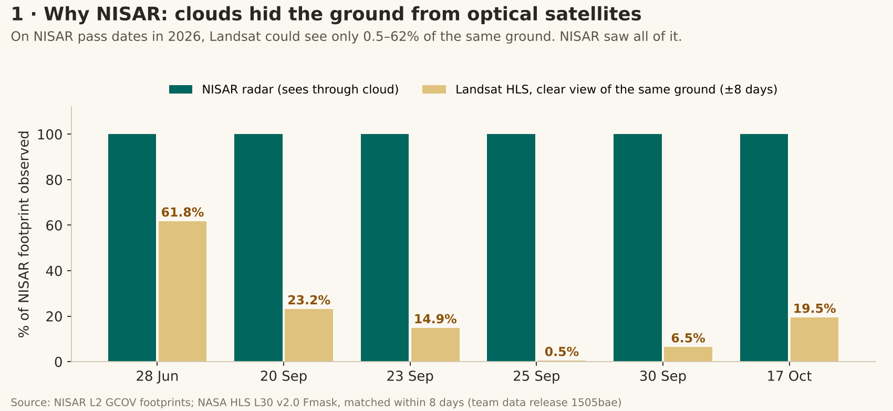
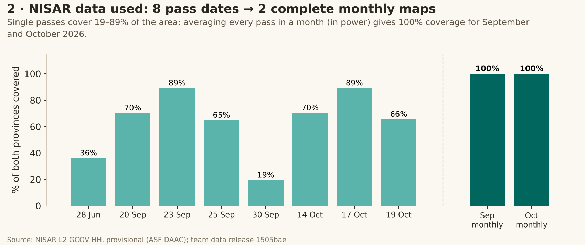
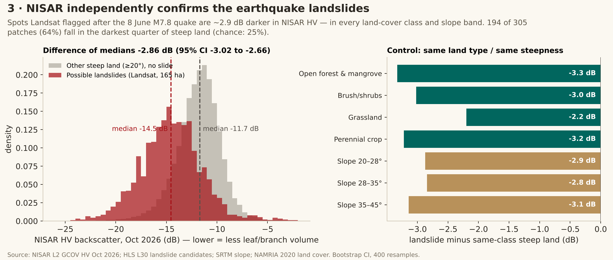
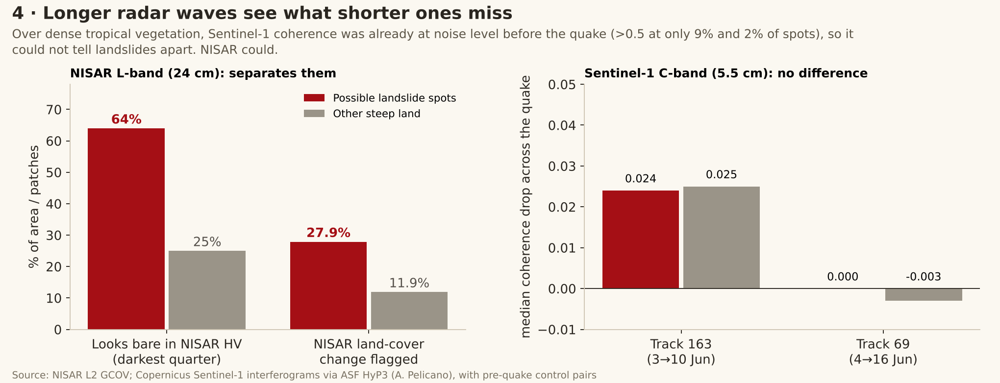
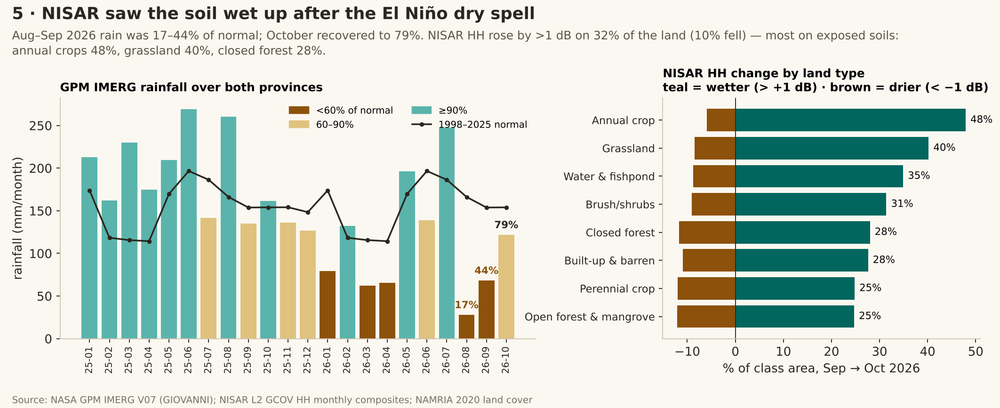
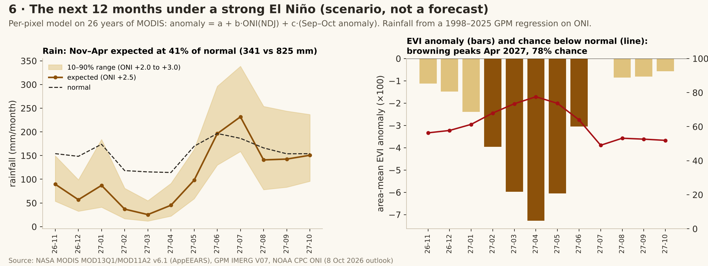
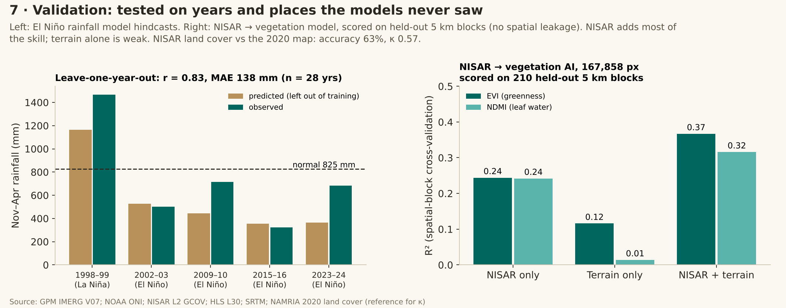
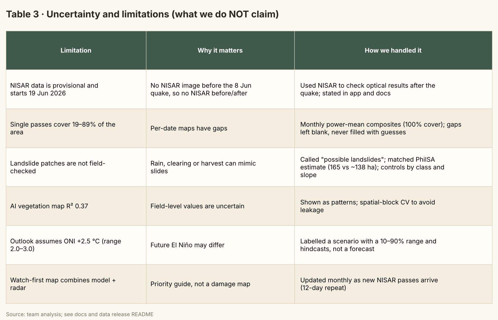
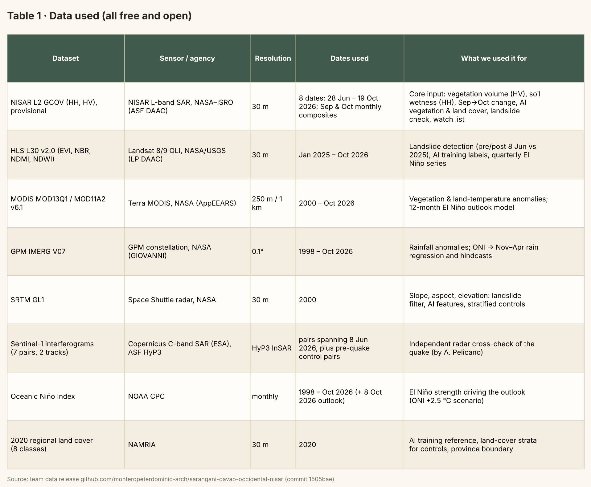

# Science and data: what NISAR shows over Sarangani and Davao Occidental

Hypotheses, tests with controls, results and limits behind the NISAR Surface Change Monitor app ([live app](https://drakaniia.github.io/Dancing_with_the_SARs/app/)). Every number here can be reproduced from this repository:

```
python science/stats.py && python science/figs.py && python science/tables.py
python science/landslides_nisar_check.py   # tags the 305 landslide patches with the NISAR check
python science/watch_first.py              # NISAR x El Niño "watch first" classes
```

## Hypotheses and results


## 1. Why NISAR: clouds hid the ground



## 2. NISAR confirms the earthquake landslides (H1)
The 305 patches flagged by Landsat after the 8 June 2026 M7.8 quake are 2.86 dB darker in NISAR HV (Oct 2026) than other steep land (95% bootstrap CI −3.02 to −2.66 dB).
- The gap holds within every 2020 land-cover class (−2.2 to −3.3 dB) and every slope band (−2.8 to −3.1 dB).
- 194 of 305 patches (64%) fall in the darkest quarter of steep land, where chance would give 25%. See [`landslides_nisar_check.geojson`](landslides_nisar_check.geojson).



## 3. Longer waves see what shorter ones miss (H2, a null result)


## 4. NISAR saw the soil wet up after the El Niño dry spell (H3)


## 5. The next 12 months (H4, scenario)


## 6. Validation (H4, H5)


## Limits


## Data


`inputs_summary.json` holds the stored model and rainfall results these figures read. `stats.json` holds the statistics computed from the rasters in this repository.

*AI assistance: Claude (Anthropic) helped write and run these scripts and charts. The team chose the methods and checked the results.*
